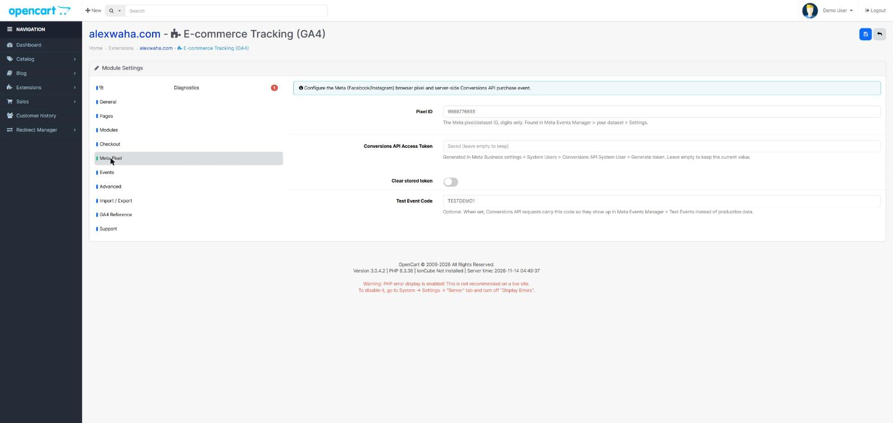

# Documentation | Alexwaha.com - E-commerce Tracking (GA4)

> **Live demo:** see this module on the live demo store - [demo.alexwaha.com/module-ecommerce-tracking](https://demo.alexwaha.com/module-ecommerce-tracking)

**for Opencart v2.3 - 3.x**

---

## Table of Contents

1. [Module Information](#module-information)
2. [Installation Guide](#installation-guide)
3. [Updating from an Older Version](#updating-from-an-older-version)
4. [Module Settings](#module-settings)
5. [GTM / gtag.js Integration](#gtm--gtagjs-integration)
6. [Server-Side GA4 Purchase (Measurement Protocol)](#server-side-ga4-purchase-measurement-protocol)
7. [Google Ads Conversion Tracking](#google-ads-conversion-tracking)
8. [Meta Pixel and Conversions API](#meta-pixel-and-conversions-api)
9. [Consent and the GDPR Cookie Consent Module](#consent-and-the-gdpr-cookie-consent-module)
10. [GA4 Events Reference](#ga4-events-reference)
11. [Diagnostics](#diagnostics)
12. [Import / Export](#import--export)
13. [For Developers](#for-developers)
14. [Troubleshooting](#troubleshooting)
15. [License and Contacts](#license-and-contacts)

---

## Module Information

**E-commerce Tracking (GA4)** is an OpenCart module that sends a full set of Google Analytics 4 e-commerce events from your store, on the browser side through dataLayer for Google Tag Manager or gtag.js, and on the server side straight to Google and Meta. One module covers the whole funnel: product views, cart, checkout, the order success page, and the purchase itself, no matter which payment method the customer used.

### Key Features

- **Full GA4 e-commerce funnel** - view_item_list, view_item, add_to_cart, remove_from_cart, view_cart, begin_checkout, add_shipping_info, add_payment_info, purchase, search, login, sign_up, add_to_wishlist, coupon/voucher events
- **Event-based integration** - uses the OpenCart event system, no OCMOD template modifications, works with any theme
- **Purchase always fires** - the purchase event is sent on the order success page regardless of payment method, with duplicate protection so a page refresh never double-counts an order
- **Server-side GA4 purchase** - sends the purchase event straight to Google through the GA4 Measurement Protocol, independent of ad blockers and browser tracking prevention
- **Google Ads conversion tracking** - fires the Ads purchase conversion with the correct value and currency on the success page
- **Meta Pixel and Conversions API** - browser pixel plus a matching server-side purchase event, deduplicated by order ID
- **Consent-aware** - works together with the alexwaha.com GDPR Consent module so tracking only runs with the visitor's consent
- **Diagnostics** - a built-in check confirms every event is registered and every required field is filled
- **Import / Export** - back up and restore all module settings as a JSON file
- **Debug mode** - inspect dataLayer events in the browser console and test the Measurement Protocol without affecting live data

### Technical Specifications

- **Author:** Alexander Vakhovski (AlexWaha)
- **Website:** [https://alexwaha.com](https://alexwaha.com)
- **License:** GPLv3
- **Compatibility:** OpenCart 2.3.x - 3.x
- **Module Code:** `aw_ecommerce_tracking`

---

## Installation Guide

### Prerequisites

1. Install **[aw_core_oc2.3-3.x.ocmod.zip](https://github.com/AlexWaha/opencart-bundle/blob/main/Core/dist/aw_core_oc2.3_3.x.ocmod.zip)**

2. For OpenCart 2.3.x: disable the FTP upload check for extensions, or make sure your FTP settings are correct

### Installation

1. Upload **aw_ecommerce_tracking_oc2.3-3.x.ocmod.zip** via **Extensions → Installer**

2. Enable the module: **Extensions → Modules → alexwaha.com - E-commerce Tracking (GA4) → Install**

3. Open the module settings and fill in the GTM/gtag.js code on the **General** tab, then add GA4, Google Ads or Meta fields as needed (see below)

4. Open the **Diagnostics** tab and confirm all events show "OK"

### Important Notes

- **No OCMOD refresh needed** - the module uses OpenCart events, not OCMOD modifications
- **No template edits needed** - works with any theme out of the box

---

## Updating from an Older Version

Updating an existing installation does not require a reinstall, your settings are kept.

1. Download the new `aw_ecommerce_tracking_oc2.3-3.x.ocmod.zip` and replace the module files with the ones from the archive (via **Extensions → Installer**, or by uploading over FTP)
2. Open **Extensions → Modules → alexwaha.com - E-commerce Tracking (GA4)** once as an administrator and save the settings

The module adds any new database columns and registers any new events by itself the moment the settings page opens. No manual reinstall, no modification cache refresh.

---

## Module Settings

### Tab "General"

| Setting | Description |
|---------|-------------|
| **Status** | Enable/disable the module |
| **GTM/gtag.js Code (Head)** | Google Tag Manager or gtag.js code pasted into `<head>` |
| **GTM Code (Body)** | GTM noscript code pasted into `<body>` |
| **Debug Mode** | Logs every dataLayer event to the browser console |
| **GA4 Measurement ID** | Your GA4 property Measurement ID, starts with `G-`. Required for server-side purchase tracking |
| **GA4 API Secret** | Measurement Protocol API secret, created in GA4 Admin → Data Streams → Measurement Protocol API secrets. Leave empty to keep the stored value |
| **Measurement Protocol Debug Mode** | Sends purchase events to the GA4 debug/validation endpoint instead of the live one, no real events are recorded while enabled |
| **Google Ads Conversion ID** | Your Google Ads conversion ID, starts with `AW-` |
| **Google Ads Conversion Label** | The conversion label of your purchase conversion action |

### Tab "Meta Pixel"



Configure the Meta (Facebook/Instagram) browser pixel and the server-side Conversions API purchase event.

| Setting | Description |
|---------|-------------|
| **Pixel ID** | The Meta pixel/dataset ID, digits only. Found in Meta Events Manager → your dataset → Settings |
| **Conversions API Access Token** | Generated in Meta Business settings → System Users → Conversions API System User → Generate token. Leave empty to keep the stored value |
| **Clear stored token** | Removes the saved access token |
| **Test Event Code** | Optional. When set, Conversions API requests carry this code so they show up in Meta Events Manager → Test Events instead of production data |

### Tab "Pages"

Tracking `view_item_list` and `view_item`:

| Setting | Event | Description |
|---------|-------|-------------|
| Category Pages | `view_item_list` | Product lists in categories |
| Search Results | `view_item_list` + `search` | Search page with search term |
| Manufacturer Pages | `view_item_list` | Brand pages |
| Special Pages | `view_item_list` | Special offers |
| Product Pages | `view_item` | Product card |
| Compare Page | `view_item_list` | Product comparison |

### Tab "Modules"

Tracking `view_item_list` for modules:

- Latest Module
- Featured Module
- Bestseller Module
- Special Module
- AW Viewed Module

### Tab "Checkout"

| Setting | Event | Description |
|---------|-------|-------------|
| Add to Cart | `add_to_cart` | Adding a product |
| Remove from Cart | `remove_from_cart` | Removing a product |
| View Cart | `view_cart` | Cart page / Easy Checkout |
| Begin Checkout | `begin_checkout` | Checkout page / Easy Checkout |
| Shipping Info | `add_shipping_info` | Shipping method selected |
| Payment Info | `add_payment_info` | Payment method selected |
| Purchase | `purchase` | Order success page, any payment method, duplicate-safe |

**Additional:**
- Include tax in prices
- Track shipping cost
- Track coupons/discounts

### Tab "Events"

| Setting | Event | Description |
|---------|-------|-------------|
| User Login | `login` | Successful login |
| Registration | `sign_up` | New account created |
| Add to Wishlist | `add_to_wishlist` | Wishlist |
| Select Item | `select_item` | Click on a product in a list |
| Apply Coupon | `add_coupon` / `add_voucher` | Discount codes and gift vouchers |

### Tab "Advanced"

| Setting | Description |
|---------|-------------|
| Currency | Session or store currency |
| Prices with Tax | Include tax in prices |
| Send Product Options | Add `item_variant` |
| Custom Parameters | JSON with additional data merged into every event |

---

## GTM / gtag.js Integration

### Google Tag Manager Setup

1. **DataLayer Variable:**
   - Variables → New → Data Layer Variable
   - Name: `ecommerce`, Version 2

2. **Trigger:**
   - Triggers → New → Custom Event
   - Event name: `view_item_list|view_item|select_item|add_to_cart|remove_from_cart|view_cart|begin_checkout|add_shipping_info|add_payment_info|purchase|search`
   - Use regex matching: checked

3. **GA4 Event Tag:**
   - Tags → New → Google Analytics: GA4 Event
   - Event Name: `{{Event}}`
   - Event Parameters: `ecommerce` → `{{ecommerce}}`

### Verification

1. Enable Debug Mode in the module
2. Open GTM Preview
3. Check events in the browser console and in GTM Preview

---

## Server-Side GA4 Purchase (Measurement Protocol)

Client-side purchase events can be lost to ad blockers, browser tracking prevention, or a visitor closing the tab before the request fires. To cover that gap, the module can send the purchase event a second time, straight from your server to Google.

### Setup

1. In GA4, open **Admin → Data Streams → your web stream → Measurement Protocol API secrets** and create a secret
2. Paste the **Measurement ID** (`G-...`) and the **API Secret** into the module's General tab
3. Save

### How and when it sends

- The event is sent when an order reaches one of the **Processing** or **Complete** order statuses configured under **System → Settings → your store → Order** - not at checkout itself, so it follows your store's actual payment confirmation
- Each order is sent once; the module keeps a record per order so re-saving the order status does not send a duplicate
- **Measurement Protocol Debug Mode** routes the request to GA4's debug/validation endpoint instead of the live one and does not mark the order as sent, so you can test repeatedly without losing a real send
- If your GDPR Consent module is installed and enabled, the send also respects the visitor's analytics consent (see [Consent](#consent-and-the-gdpr-cookie-consent-module))

---

## Google Ads Conversion Tracking

Fill in your **Google Ads Conversion ID** (`AW-...`) and **Conversion Label** on the General tab. When both fields are filled, the module fires the standard Ads conversion snippet on the order success page together with the client-side purchase event, using the order's real value, currency and transaction ID.

---

## Meta Pixel and Conversions API

The module can track purchases for Meta (Facebook/Instagram) ads in two complementary ways, configured on the **Meta Pixel** tab.

### Browser pixel

Enter your **Pixel ID** (digits only, from Meta Events Manager → your dataset → Settings). Once set, the module loads the Meta pixel in the browser and sends `ViewContent`, `AddToCart`, `InitiateCheckout` and `Purchase` events that mirror the GA4 funnel.

### Conversions API (server-side)

Enter the **Conversions API Access Token** (from Meta Business settings → System Users → Conversions API System User → Generate token). The module then also sends the purchase event from your server, the same way the GA4 Measurement Protocol send works: when the order reaches a Processing or Complete status, once per order.

### Deduplication

The browser pixel and the server-side Conversions API send the same order's purchase event with the same event ID (the order ID), so Meta deduplicates them automatically - you get the reliability of a server-side send without counting the purchase twice.

### Test Event Code

Set the **Test Event Code** field to see incoming events live under Meta Events Manager → Test Events, without mixing test traffic into your production data. Clear the field once you are done testing.

---

## Consent and the GDPR Cookie Consent Module

If the **alexwaha.com - GDPR Consent** module is installed and enabled on your store, E-commerce Tracking automatically respects the visitor's choice:

- The **Meta browser pixel** only loads after the visitor grants the marketing/advertising cookie category
- The **GA4 Measurement Protocol** send only fires if analytics consent was granted at the time of the order
- The **Meta Conversions API** send only fires if advertising consent was granted at the time of the order

If the GDPR Consent module is not installed, none of this is gated, tracking runs as soon as the fields above are configured. Google Tag Manager/gtag.js and Google Ads client-side tracking follow whatever consent setup you configure inside GTM/gtag itself; this module does not override it.

---

## GA4 Events Reference

| Event | When Triggered | Type |
|-------|----------------|------|
| `view_item_list` | Product list view | Server |
| `view_item` | Product card view | Server |
| `search` | Search page (with search_term) | Server |
| `select_item` | Click on product in list | JS |
| `add_to_cart` | Add to cart | JS |
| `remove_from_cart` | Remove from cart | JS |
| `view_cart` | Cart view | Server |
| `begin_checkout` | Begin checkout | Server |
| `add_shipping_info` | Shipping selection | JS |
| `add_payment_info` | Payment selection | JS |
| `purchase` | Order success page (client-side) + Measurement Protocol (server-side) | Server + JS |
| `login` | Account login | Server |
| `sign_up` | Registration | Server |
| `add_to_wishlist` | Add to wishlist | JS |
| `add_coupon` / `add_voucher` | Apply coupon or gift voucher | JS |

**Type:** Server = sent by PHP on page load or order status change, JS = sent by the browser on a user action

---

## Diagnostics

The **Diagnostics** tab (first tab in module settings) provides real-time validation:

### Event Registration Check
- Confirms all OpenCart events the module needs are registered
- Shows each event trigger with an OK/MISSING status
- If events are missing: reinstall the module (Extensions → Modules → Uninstall → Install)

### Configuration Check
- Checks that the GTM/gtag.js code is filled in
- Checks that the module status is enabled
- Clickable links to jump to the relevant settings tab

### Badge Indicator
- Green "OK" badge on the Diagnostics tab = no issues
- Red badge with a number = count of problems found

---

## Import / Export

The **Import / Export** tab lets you back up and restore all module settings:

### Export
- Downloads the current configuration as a JSON file
- Filename format: `aw_ecommerce_tracking_settings_YYYY-MM-DD_HH-MM-SS.json`

### Import
- Upload a previously exported JSON file
- Overwrites all current settings (confirmation required)
- The page reloads automatically after a successful import

---

## For Developers

### How It Works

The module uses OpenCart's native event system instead of OCMOD modifications. During installation the required events are registered in the `oc_event` database table.

**Global events (every page):**
- `catalog/view/common/header/after` - injects GTM/gtag code + JS config into `<head>`
- `catalog/view/common/footer/after` - injects GTM body code + deferred login/signup events

**Page-specific events:**
- `catalog/view/product/category/after`, `.../search/after`, `.../manufacturer_info/after`, `.../special/after`, `.../product/after`

**Checkout events:**
- `catalog/view/checkout/cart/after`, `catalog/view/checkout/checkout/after`
- `catalog/controller/extension/aw_easy_checkout/main/after` - AW Easy Checkout
- `catalog/view/common/success/after` - client-side `purchase` on the order success page

**Order lifecycle events (server-side tracking):**
- `catalog/model/checkout/order/addOrder/after` - captures the GA4 client/session ID and the Meta `fbp`/`fbc` cookies together with the consent flags at the moment the order is placed
- `catalog/model/checkout/order/addOrderHistory/after` - fires the GA4 Measurement Protocol send and the Meta Conversions API send when the order reaches a Processing or Complete status

**Account events:**
- `catalog/controller/account/login/after`, `catalog/controller/account/register/after`

**Module events:**
- `catalog/view/extension/module/featured/after`, `.../latest/after`, `.../bestseller/after`, `.../special/after`

### Event Handler

All catalog events are handled by `catalog/controller/extension/aw_ecommerce_tracking/event.php`, which extracts product IDs from the template data, re-queries raw product data via the model, delegates to the business-logic controller (`extension/module/aw_ecommerce_tracking`), and injects the returned tracking HTML into `$output`.

### JavaScript API

```javascript
// Add to cart
window.awEcommerceTracking.trackAddToCart({
    id: '42',
    name: 'iPhone 15',
    price: 999.00,
    brand: 'Apple',
    category: 'Smartphones'
}, 1);

// Remove from cart
window.awEcommerceTracking.trackRemoveFromCart(product, quantity);

// Select item
window.awEcommerceTracking.trackSelectItem(product, listName, listId, index);

// Apply coupon
window.awEcommerceTracking.trackCoupon('SALE10', 'coupon');

// Custom event
window.awEcommerceTracking.push({ event: 'custom', data: 'value' });
```

### PHP API

```php
// In controller
$tracking = $this->load->controller('extension/module/aw_ecommerce_tracking');

if ($tracking->isEnabled()) {
    $eventData = $tracking->prepareViewItemList($products, 'My List', 'my_list');
    $html = $tracking->renderDataLayer($eventData);
}
```

---

## Troubleshooting

### Events not sending

1. Open the **Diagnostics** tab - check that all events are registered
2. Check that the module status is enabled
3. Check that the GTM/gtag.js code is in General settings
4. If events are missing: reinstall the module

### Error "awCore is not defined"

Install the **aw_core_oc2.3-3.x.ocmod.zip** module

### Events duplicating

1. Check Extensions → Modifications for an old `aw_ecommerce_tracking` OCMOD entry - delete it and refresh the modification cache
2. Check that the GTM/gtag.js code is only in the module settings, not also pasted manually into a theme template

### add_to_cart not firing

1. Check the console for errors
2. Make sure `cart.add()` exists on the page
3. Use the JS API for custom themes

### Purchase event fires on page refresh

The module has built-in protection - the `purchase` event fires only once per order on the success page. If you still see duplicates, check for old OCMOD modifications left over from a previous version.

### Server-side purchase (GA4 / Meta) not arriving

1. Confirm the order actually reached one of the Processing or Complete statuses configured in Settings → your store → Order
2. Confirm the Measurement ID + API Secret (GA4) or Pixel ID + Access Token (Meta) are filled in and saved
3. If the GDPR Consent module is active, confirm the visitor granted the relevant consent category before checking out
4. Turn off Measurement Protocol Debug Mode once you have confirmed test events arrive, debug sends are never counted as delivered

### AW Easy Checkout - no events

The module registers a dedicated controller event for Easy Checkout. If events are missing, reinstall the module to re-register it.

---

## License and Contacts

### License

[GNU General Public License version 3 (GPLv3)](https://github.com/alexwaha/opencart-bundle/blob/main/LICENSE)

**Author:** Alexander Vakhovski (Oleksandr Vakhovskyi) / Alexwaha

### Contacts

- **Telegram:** [@alexwaha_dev](https://t.me/alexwaha_dev)
- **Email:** [support@alexwaha.com](mailto:support@alexwaha.com)
- **GitHub:** [https://github.com/AlexWaha/opencart-bundle](https://github.com/AlexWaha/opencart-bundle)
- **Contact us:** [https://alexwaha.com/contact](https://alexwaha.com/contact)

> Technical support available on paid basis. Pull Requests welcome.

---

**Alexwaha.com - E-commerce Tracking (GA4) for OpenCart**
