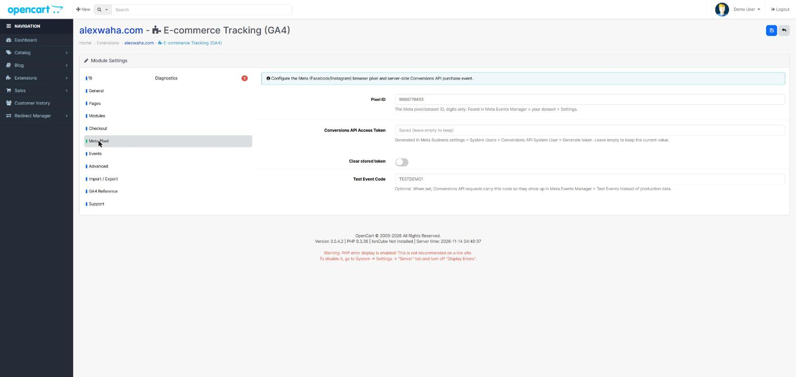

# Инструкция | Alexwaha.com - E-commerce Tracking (GA4)

> **Живое демо:** посмотреть модуль на демо-витрине - [demo.alexwaha.com/module-ecommerce-tracking](https://demo.alexwaha.com/module-ecommerce-tracking)

**для Opencart v2.3 - 3.x**

---

## Содержание

1. [Информация о модуле](#информация-о-модуле)
2. [Инструкция по установке](#инструкция-по-установке)
3. [Обновление с предыдущей версии](#обновление-с-предыдущей-версии)
4. [Настройки модуля](#настройки-модуля)
5. [Интеграция с GTM / gtag.js](#интеграция-с-gtm--gtagjs)
6. [Серверная отправка покупки GA4 (Measurement Protocol)](#серверная-отправка-покупки-ga4-measurement-protocol)
7. [Конверсии Google Ads](#конверсии-google-ads)
8. [Meta Pixel и Conversions API](#meta-pixel-и-conversions-api)
9. [Согласие и модуль GDPR Cookie Consent](#согласие-и-модуль-gdpr-cookie-consent)
10. [Справочник событий GA4](#справочник-событий-ga4)
11. [Диагностика](#диагностика)
12. [Импорт / Экспорт](#импорт--экспорт)
13. [Для разработчиков](#для-разработчиков)
14. [Решение проблем](#решение-проблем)
15. [Лицензия и контакты](#лицензия-и-контакты)

---

## Информация о модуле

**E-commerce Tracking (GA4)** - модуль OpenCart, который отправляет полный набор событий Google Analytics 4 e-commerce: на стороне браузера через dataLayer для Google Tag Manager или gtag.js, и на стороне сервера напрямую в Google и Meta. Один модуль закрывает всю воронку: просмотры товаров, корзина, оформление заказа, страница успешного заказа и сама покупка - независимо от выбранного способа оплаты.

### Основные возможности

- **Полная воронка GA4 e-commerce** - view_item_list, view_item, add_to_cart, remove_from_cart, view_cart, begin_checkout, add_shipping_info, add_payment_info, purchase, search, login, sign_up, add_to_wishlist, события купонов/сертификатов
- **Интеграция через события** - использует систему событий OpenCart, без OCMOD-модификаций шаблонов, работает с любой темой
- **Purchase срабатывает всегда** - событие purchase отправляется на странице успешного заказа независимо от способа оплаты, с защитой от дублей, чтобы обновление страницы не засчитало заказ повторно
- **Серверная отправка покупки GA4** - отправляет событие purchase напрямую в Google через GA4 Measurement Protocol, независимо от блокировщиков рекламы и ограничений трекинга в браузере
- **Конверсии Google Ads** - отправляет конверсию покупки Google Ads с правильной суммой и валютой на странице успешного заказа
- **Meta Pixel и Conversions API** - браузерный пиксель плюс серверное событие покупки с дедупликацией по ID заказа
- **Учёт согласия** - работает совместно с модулем alexwaha.com GDPR Consent, чтобы отслеживание запускалось только с согласия посетителя
- **Диагностика** - встроенная проверка подтверждает регистрацию всех событий и заполненность нужных полей
- **Импорт / Экспорт** - резервное копирование и восстановление всех настроек модуля в JSON
- **Режим отладки** - просмотр событий dataLayer в консоли браузера и тестирование Measurement Protocol без влияния на реальные данные

### Технические характеристики

- **Автор:** Alexander Vakhovski (AlexWaha)
- **Сайт:** [https://alexwaha.com](https://alexwaha.com)
- **Лицензия:** GPLv3
- **Совместимость:** OpenCart 2.3.x - 3.x
- **Код модуля:** `aw_ecommerce_tracking`

---

## Инструкция по установке

### Требования

1. Установите **[aw_core_oc2.3-3.x.ocmod.zip](https://github.com/AlexWaha/opencart-bundle/blob/main/Core/dist/aw_core_oc2.3_3.x.ocmod.zip)**

2. Для OpenCart 2.3.x: отключите проверку FTP при загрузке дополнений или убедитесь, что настройки FTP корректны

### Установка

1. Загрузите **aw_ecommerce_tracking_oc2.3-3.x.ocmod.zip** через **Расширения → Установка расширений**

2. Включите модуль: **Расширения → Модули → alexwaha.com - E-commerce Tracking (GA4) → Установить**

3. Откройте настройки модуля и заполните код GTM/gtag.js на вкладке **Общие**, затем при необходимости заполните поля GA4, Google Ads или Meta (см. ниже)

4. Откройте вкладку **Диагностика** и убедитесь, что все события показывают "OK"

### Важно

- **Обновление кэша OCMOD не требуется** - модуль использует события OpenCart, а не OCMOD
- **Редактирование шаблонов не требуется** - работает с любой темой

---

## Обновление с предыдущей версии

Обновление существующей установки не требует переустановки модуля, все настройки сохраняются.

1. Скачайте новый `aw_ecommerce_tracking_oc2.3-3.x.ocmod.zip` и замените файлы модуля файлами из архива (через **Расширения → Установка расширений** или загрузкой по FTP)
2. Один раз откройте **Расширения → Модули → alexwaha.com - E-commerce Tracking (GA4)** от имени администратора и сохраните настройки

Модуль сам добавляет новые столбцы в базе данных и регистрирует новые события в момент открытия страницы настроек. Переустановка и обновление кэша модификаций не требуются.

---

## Настройки модуля

### Вкладка «Общие»

| Настройка | Описание |
|-----------|----------|
| **Статус** | Включить/выключить модуль |
| **Код GTM/gtag.js (Head)** | Код Google Tag Manager или gtag.js, вставляется в `<head>` |
| **Код GTM (Body)** | Noscript-код GTM, вставляется в `<body>` |
| **Режим отладки** | Выводит каждое событие dataLayer в консоль браузера |
| **GA4 Measurement ID** | Measurement ID вашего ресурса GA4, начинается с `G-`. Нужен для серверной отправки покупок |
| **GA4 API Secret** | API secret Measurement Protocol, создаётся в GA4 Admin → Data Streams → Measurement Protocol API secrets. Оставьте пустым, чтобы сохранить текущее значение |
| **Режим отладки Measurement Protocol** | Отправляет события покупок на отладочный эндпоинт GA4 вместо рабочего, реальные события при этом не записываются |
| **Google Ads Conversion ID** | ID конверсии Google Ads, начинается с `AW-` |
| **Google Ads Conversion Label** | Метка конверсии действия «Покупка» |

### Вкладка «Meta Pixel»



Настройка браузерного пикселя Meta (Facebook/Instagram) и серверного события покупки Conversions API.

| Настройка | Описание |
|-----------|----------|
| **ID пикселя** | ID пикселя/набора данных Meta, только цифры. Находится в Meta Events Manager → ваш набор данных → Настройки |
| **Токен доступа Conversions API** | Создаётся в настройках Meta Business → Системные пользователи → Системный пользователь Conversions API → Создать токен. Оставьте пустым, чтобы сохранить текущее значение |
| **Удалить сохранённый токен** | Удаляет сохранённый токен доступа |
| **Код тестового события** | Необязательно. Если указан, запросы Conversions API помечаются этим кодом и отображаются в Meta Events Manager → Test Events вместо рабочих данных |

### Вкладка «Страницы»

Отслеживание `view_item_list` и `view_item`:

| Настройка | Событие | Описание |
|-----------|---------|----------|
| Страницы категорий | `view_item_list` | Списки товаров в категориях |
| Результаты поиска | `view_item_list` + `search` | Страница поиска с поисковым запросом |
| Страницы производителей | `view_item_list` | Страницы брендов |
| Страницы акций | `view_item_list` | Специальные предложения |
| Страницы товаров | `view_item` | Карточка товара |
| Страница сравнения | `view_item_list` | Сравнение товаров |

### Вкладка «Модули»

Отслеживание `view_item_list` для модулей:

- Модуль новинок
- Модуль рекомендуемых
- Модуль хитов продаж
- Модуль акций
- Модуль просмотренных (AW)

### Вкладка «Оформление заказа»

| Настройка | Событие | Описание |
|-----------|---------|----------|
| Добавление в корзину | `add_to_cart` | Добавление товара |
| Удаление из корзины | `remove_from_cart` | Удаление товара |
| Просмотр корзины | `view_cart` | Страница корзины / Easy Checkout |
| Начало оформления | `begin_checkout` | Страница чекаута / Easy Checkout |
| Информация о доставке | `add_shipping_info` | Выбор способа доставки |
| Информация об оплате | `add_payment_info` | Выбор способа оплаты |
| Покупка | `purchase` | Страница успешного заказа, для любого способа оплаты, защищена от дублей |

**Дополнительно:**
- **Сумма покупки** - что отправлять в параметре `value` события покупки: *Сумма заказа* (по умолчанию, с налогом и доставкой; цены товаров в массиве `items` подчиняются "Цены с налогом") или *Только товары* (сумма цена x количество, без доставки, сборов и скидок по купону/подарочному сертификату/бонусам; в этом режиме и `value`, и цены товаров в `items` ВСЕГДА без налога, независимо от "Цены с налогом", поэтому `value` равен сумме товаров). Применяется к событию purchase на витрине, отправке через GA4 Measurement Protocol, конверсии Google Ads и отправке в Meta Conversions API
- Включать налог - добавляет сумму налога заказа отдельным параметром `tax` в событие покупки (не влияет на цены товаров)
- Отслеживать стоимость доставки
- Отслеживать купоны/скидки

### Вкладка «События»

| Настройка | Событие | Описание |
|-----------|---------|----------|
| Вход пользователя | `login` | Успешный вход |
| Регистрация | `sign_up` | Создан новый аккаунт |
| Добавление в избранное | `add_to_wishlist` | Список желаний |
| Выбор товара | `select_item` | Клик по товару в списке |
| Применение купона | `add_coupon` / `add_voucher` | Коды скидок и подарочные сертификаты |

### Вкладка «Расширенные»

| Настройка | Описание |
|-----------|----------|
| Валюта | Валюта сессии или магазина |
| Цены с налогом | Включать налог в цены |
| Отправлять опции товара | Добавлять `item_variant` |
| Пользовательские параметры | JSON с дополнительными данными, добавляется в каждое событие |

---

## Интеграция с GTM / gtag.js

### Настройка Google Tag Manager

1. **Переменная DataLayer:**
   - Переменные → Создать → Переменная уровня данных
   - Имя: `ecommerce`, Версия 2

2. **Триггер:**
   - Триггеры → Создать → Специальное событие
   - Имя события: `view_item_list|view_item|select_item|add_to_cart|remove_from_cart|view_cart|begin_checkout|add_shipping_info|add_payment_info|purchase|search`
   - Использовать регулярные выражения: включено

3. **Тег GA4:**
   - Теги → Создать → Google Analytics: событие GA4
   - Имя события: `{{Event}}`
   - Параметры события: `ecommerce` → `{{ecommerce}}`

### Проверка

1. Включите режим отладки в модуле
2. Откройте GTM Preview
3. Проверьте события в консоли браузера и в GTM Preview

---

## Серверная отправка покупки GA4 (Measurement Protocol)

Браузерное событие покупки может потеряться из-за блокировщика рекламы, ограничений трекинга в браузере или если посетитель закрыл вкладку раньше, чем успел отправиться запрос. Чтобы закрыть этот пробел, модуль может отправить событие покупки повторно, напрямую с вашего сервера в Google.

### Настройка

1. В GA4 откройте **Admin → Data Streams → ваш веб-поток → Measurement Protocol API secrets** и создайте secret
2. Вставьте **Measurement ID** (`G-...`) и **API Secret** в настройки модуля на вкладке «Общие»
3. Сохраните

### Как и когда отправляется

- Событие отправляется, когда заказ переходит в один из статусов «В обработке» или «Выполнен», настроенных в **Система → Настройки → ваш магазин → Заказ** - не в момент оформления заказа, а в соответствии с реальным подтверждением оплаты в вашем магазине
- Каждый заказ отправляется один раз: модуль хранит отметку по заказу, поэтому повторное сохранение статуса заказа не создаёт дубль
- **Режим отладки Measurement Protocol** направляет запрос на отладочный/валидационный эндпоинт GA4 вместо рабочего и не помечает заказ как отправленный, поэтому можно тестировать повторно без потери реальной отправки
- Если модуль GDPR Consent установлен и включён, отправка также учитывает согласие посетителя на аналитику (см. [Согласие](#согласие-и-модуль-gdpr-cookie-consent))

---

## Конверсии Google Ads

Заполните **Google Ads Conversion ID** (`AW-...`) и **Google Ads Conversion Label** на вкладке «Общие». Когда оба поля заполнены, модуль отправляет стандартный сниппет конверсии Ads на странице успешного заказа вместе с браузерным событием покупки, используя реальную сумму заказа, валюту и ID транзакции.

---

## Meta Pixel и Conversions API

Модуль умеет отслеживать покупки для рекламы Meta (Facebook/Instagram) двумя дополняющими друг друга способами - настраиваются на вкладке **Meta Pixel**.

### Браузерный пиксель

Укажите **ID пикселя** (только цифры, из Meta Events Manager → ваш набор данных → Настройки). После заполнения модуль загружает пиксель Meta в браузере и отправляет события `ViewContent`, `AddToCart`, `InitiateCheckout` и `Purchase`, повторяющие воронку GA4.

### Conversions API (на сервере)

Укажите **Токен доступа Conversions API** (из настроек Meta Business → Системные пользователи → Системный пользователь Conversions API → Создать токен). После этого модуль дополнительно отправляет событие покупки с вашего сервера - так же, как работает отправка GA4 Measurement Protocol: когда заказ переходит в статус «В обработке» или «Выполнен», один раз на заказ.

### Дедупликация

Браузерный пиксель и серверная отправка Conversions API передают событие покупки одного и того же заказа с одинаковым ID события (ID заказа), поэтому Meta автоматически устраняет дубли - вы получаете надёжность серверной отправки без двойного учёта покупки.

### Код тестового события

Заполните поле **Код тестового события**, чтобы видеть входящие события в реальном времени в Meta Events Manager → Test Events, без попадания тестового трафика в рабочие данные. Очистите поле после завершения тестирования.

---

## Согласие и модуль GDPR Cookie Consent

Если на вашем магазине установлен и включён модуль **alexwaha.com - GDPR Consent**, E-commerce Tracking автоматически учитывает выбор посетителя:

- **Браузерный пиксель Meta** загружается только после того, как посетитель разрешил категорию маркетинговых/рекламных cookie
- **Отправка GA4 Measurement Protocol** срабатывает только если на момент заказа было дано согласие на аналитику
- **Отправка Meta Conversions API** срабатывает только если на момент заказа было дано согласие на рекламу

Если модуль GDPR Consent не установлен, никаких ограничений нет - отслеживание работает сразу после заполнения указанных выше полей. Клиентское отслеживание через Google Tag Manager/gtag.js и Google Ads зависит от того, как вы настроили согласие внутри самого GTM/gtag - этот модуль не переопределяет такие настройки.

---

## Справочник событий GA4

| Событие | Когда срабатывает | Тип |
|---------|-------------------|-----|
| `view_item_list` | Просмотр списка товаров | Сервер |
| `view_item` | Просмотр карточки товара | Сервер |
| `search` | Страница поиска (с search_term) | Сервер |
| `select_item` | Клик по товару в списке | JS |
| `add_to_cart` | Добавление в корзину | JS |
| `remove_from_cart` | Удаление из корзины | JS |
| `view_cart` | Просмотр корзины | Сервер |
| `begin_checkout` | Начало оформления | Сервер |
| `add_shipping_info` | Выбор доставки | JS |
| `add_payment_info` | Выбор оплаты | JS |
| `purchase` | Страница успешного заказа (браузер) + Measurement Protocol (сервер) | Сервер + JS |
| `login` | Вход в аккаунт | Сервер |
| `sign_up` | Регистрация | Сервер |
| `add_to_wishlist` | Добавление в избранное | JS |
| `add_coupon` / `add_voucher` | Применение купона или сертификата | JS |

**Тип:** Сервер = отправляется PHP при загрузке страницы или смене статуса заказа, JS = отправляется браузером при действии пользователя

---

## Диагностика

Вкладка **Диагностика** (первая вкладка в настройках модуля) - автоматическая проверка:

### Проверка регистрации событий
- Подтверждает, что все нужные модулю события OpenCart зарегистрированы
- Каждое событие показывается со статусом OK / ОТСУТСТВУЕТ
- Если события не найдены: переустановите модуль (Расширения → Модули → Удалить → Установить)

### Проверка конфигурации
- Код GTM/gtag.js заполнен
- Модуль включён
- Ссылки для быстрого перехода к нужным настройкам

### Индикатор на вкладке
- Зелёный «OK» = нет проблем
- Красный с числом = количество найденных проблем

---

## Импорт / Экспорт

Вкладка **Импорт / Экспорт** - резервное копирование и восстановление всех настроек модуля:

### Экспорт
- Скачивает текущую конфигурацию в JSON-файл
- Формат имени: `aw_ecommerce_tracking_settings_ГГГГ-ММ-ДД_ЧЧ-ММ-СС.json`

### Импорт
- Загрузка ранее экспортированного JSON-файла
- Перезаписывает все текущие настройки (требуется подтверждение)
- Страница автоматически перезагружается после успешного импорта

---

## Для разработчиков

### Как это работает

Модуль использует нативную систему событий OpenCart вместо модификаций OCMOD. При установке нужные события регистрируются в таблице `oc_event`.

**Глобальные события (на каждой странице):**
- `catalog/view/common/header/after` - вставка кода GTM/gtag + JS-конфига в `<head>`
- `catalog/view/common/footer/after` - вставка body-кода GTM + отложенных событий login/signup

**Страничные события:**
- `catalog/view/product/category/after`, `.../search/after`, `.../manufacturer_info/after`, `.../special/after`, `.../product/after`

**Оформление заказа:**
- `catalog/view/checkout/cart/after`, `catalog/view/checkout/checkout/after`
- `catalog/controller/extension/aw_easy_checkout/main/after` - AW Easy Checkout
- `catalog/view/common/success/after` - клиентский `purchase` на странице успешного заказа

**Жизненный цикл заказа (серверное отслеживание):**
- `catalog/model/checkout/order/addOrder/after` - сохраняет GA4 client/session ID и Meta-cookie `fbp`/`fbc` вместе с флагами согласия в момент оформления заказа
- `catalog/model/checkout/order/addOrderHistory/after` - запускает отправку GA4 Measurement Protocol и Meta Conversions API, когда заказ переходит в статус «В обработке» или «Выполнен»

**Аккаунт:**
- `catalog/controller/account/login/after`, `catalog/controller/account/register/after`

**Модули:**
- `catalog/view/extension/module/featured/after`, `.../latest/after`, `.../bestseller/after`, `.../special/after`

### Event Handler

Все события каталога обрабатывает `catalog/controller/extension/aw_ecommerce_tracking/event.php`: он извлекает ID товаров из данных шаблона, заново запрашивает сырые данные через модель, делегирует в контроллер бизнес-логики (`extension/module/aw_ecommerce_tracking`) и вставляет возвращённый tracking HTML в `$output`.

### JavaScript API

```javascript
window.awEcommerceTracking.trackAddToCart(product, quantity);
window.awEcommerceTracking.trackRemoveFromCart(product, quantity);
window.awEcommerceTracking.trackSelectItem(product, listName, listId, index);
window.awEcommerceTracking.trackCoupon('SALE10', 'coupon');
window.awEcommerceTracking.push({ event: 'custom', data: 'value' });
```

---

## Решение проблем

### События не отправляются

1. Откройте вкладку **Диагностика** - проверьте, что все события зарегистрированы
2. Убедитесь, что модуль включён
3. Проверьте код GTM/gtag.js в настройках
4. Если события отсутствуют - переустановите модуль

### Ошибка «awCore is not defined»

Установите модуль **aw_core_oc2.3-3.x.ocmod.zip**

### Дублирование событий

1. Проверьте Расширения → Модификаторы на наличие старой записи `aw_ecommerce_tracking` - удалите и обновите кэш
2. Убедитесь, что код GTM/gtag.js есть только в настройках модуля, а не вручную вставлен в шаблон темы

### add_to_cart не срабатывает

1. Проверьте консоль на ошибки
2. Убедитесь, что `cart.add()` существует на странице
3. Используйте JS API для кастомных тем

### Purchase срабатывает при обновлении страницы

Модуль имеет встроенную защиту - событие `purchase` на странице успешного заказа отправляется только один раз для каждого заказа. Если дубли всё равно появляются, проверьте, не осталась ли старая OCMOD-модификация от прежней версии.

### Серверная покупка (GA4 / Meta) не приходит

1. Убедитесь, что заказ действительно перешёл в один из статусов «В обработке» или «Выполнен», настроенных в Настройки → ваш магазин → Заказ
2. Убедитесь, что Measurement ID + API Secret (GA4) или ID пикселя + токен доступа (Meta) заполнены и сохранены
3. Если модуль GDPR Consent активен, убедитесь, что посетитель дал нужное согласие до оформления заказа
4. Отключите режим отладки Measurement Protocol после того, как убедились, что тестовые события приходят - отладочные отправки никогда не засчитываются как доставленные

### AW Easy Checkout - нет событий

Модуль регистрирует отдельное событие контроллера для Easy Checkout. Если событий нет - переустановите модуль, чтобы зарегистрировать его повторно.

---

## Лицензия и контакты

### Лицензия

[GNU General Public License version 3 (GPLv3)](https://github.com/alexwaha/opencart-bundle/blob/main/LICENSE)

**Автор:** Alexander Vakhovski (Oleksandr Vakhovskyi) / Alexwaha

### Контакты

- **Telegram:** [@alexwaha_dev](https://t.me/alexwaha_dev)
- **Email:** [support@alexwaha.com](mailto:support@alexwaha.com)
- **GitHub:** [https://github.com/AlexWaha/opencart-bundle](https://github.com/AlexWaha/opencart-bundle)
- **Связаться:** [https://alexwaha.com/contact](https://alexwaha.com/contact)

> Техподдержка предоставляется на платной основе. Pull Requests приветствуются.

---

**Alexwaha.com - E-commerce Tracking (GA4) для OpenCart**
